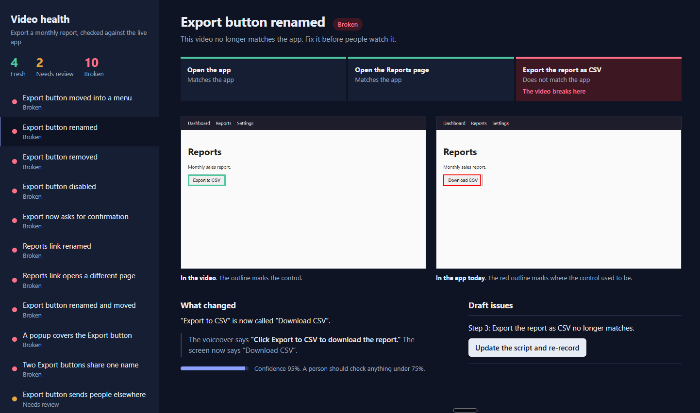

# LockStep

**Checks whether a product tutorial is still true.**

AI tools can turn a screen recording into a polished tutorial video. The video keeps looking professional after the product changes, even when it now shows a button that has moved, been renamed, or been removed. LockStep replays a tutorial's steps against the live app, says which step broke and why, and saves visual evidence.

This is an independent project. It is not affiliated with any video tool and does not use any vendor's code or API.



## What it does

1. **Lock the tutorial.** A tutorial is a YAML file: ordered steps, each with an action, a target (accessibility role plus exact name, never CSS selectors) and an expected outcome.
2. **Capture a baseline** on the clean app: a screenshot, the target's position, and the page's accessibility snapshot for every step.
3. **Replay** on the live app. A step passes only if the exact target is found, the action works, and the expected outcome is true. There is no fuzzy matching in the pass path, so a renamed or moved button can't pass by accident.
4. **Diagnose** the first failure with deterministic rules (no LLM, no paid API) and save a screenshot with the old position outlined in red.
5. **Evaluate** against deliberate changes to a demo app, and write the numbers to `out/results.md` and `out/results.json`.

## Results

Measured on the bundled demo app, 16 hand-built changes, 10 clean runs. Developed on Windows with Python 3.12.

| Metric | Result |
|---|---|
| Broken tutorials detected | 12/12 |
| False alarms on the unchanged app | 0/10 runs |
| False alarms on harmless changes | 0/4 |
| Right failing step identified | 16/16 |
| Right diagnosis | 15/16 (94%) |
| Average time per replay | about 3 s |

| Change applied to the app | Expected | Got |
|---|---|---|
| Export button moved into a menu | MOVED | MOVED |
| Export button renamed | RENAMED | RENAMED |
| Export button removed | REMOVED | REMOVED |
| Export button disabled | DISABLED | DISABLED |
| Export asks for confirmation | NEW_STEP_REQUIRED | NEW_STEP_REQUIRED |
| Reports link renamed | RENAMED | RENAMED |
| Reports link opens another page | WRONG_DESTINATION | WRONG_DESTINATION |
| Same label, button now goes elsewhere | OUTCOME_CHANGED | OUTCOME_CHANGED |
| **Renamed and moved at the same time** | MOVED | **REMOVED (miss)** |
| Cookie popup covers the button | BLOCKED | BLOCKED |
| Success message text changed | OUTCOME_CHANGED | OUTCOME_CHANGED |
| Two buttons share the same name | AMBIGUOUS_TARGET | AMBIGUOUS_TARGET |
| Slower export (harmless) | no failure | no failure |
| Button restyled (harmless) | no failure | no failure |
| Button appears 1.2 s late (harmless) | no failure | no failure |
| Menu order changed (harmless) | no failure | no failure |

## How the diagnosis works

| Label | Rule |
|---|---|
| DISABLED | The element exists but a click timed out, and it reports as disabled. |
| BLOCKED | A click timed out, the element is not disabled, and new controls appeared on top that were not in the baseline. |
| MOVED | No visible match, but the same role and name exist in the page, hidden inside something collapsed. |
| RENAMED | No exact match, but a visible element of the same role sits where the old one was (at least 40% overlap of the saved position). |
| REMOVED | None of the above. |
| WRONG_DESTINATION | The step expected a URL fragment and the page is somewhere else. |
| NEW_STEP_REQUIRED | The outcome was not met and new buttons or links appeared. |
| OUTCOME_CHANGED | The action worked but the promised result did not happen. |
| AMBIGUOUS_TARGET | More than one visible element matches the target. |

Each diagnosis carries a confidence score and evidence (old and new names, overlap, new controls, URLs).

## Run it

```powershell
git clone <this repo>
cd lockstep
python -m venv .venv
.\.venv\Scripts\Activate.ps1
pip install -r requirements.txt
python -m playwright install chromium

# terminal 1: the demo app
python demo_app\app.py

# terminal 2: evaluate, then open the review screen
python -m lockstep eval tutorials\export_report.yaml
python -m lockstep screen tutorials\export_report.yaml --open
```

Other commands: `baseline` captures the baseline, and `run --mutation move_export` replays once with one change applied. Mutations are applied on the demo server through `POST /__mutate/<name>`, so they survive page navigation.

## The Video Health screen

`out/video_health.html` is a single self-contained file built from `results.json` and the saved screenshots. It lists each checked version as Fresh, Needs review or Broken, marks the step where the video stops matching the app, compares the recorded frame with today's app, and compares the voiceover line with what the screen now says. Confidence below 75% is shown as "Needs review", so the screen says when a person should look.

It is a design concept for how a team could review stale videos. The "Re-record this step" button is a prototype and does nothing.

## Limitations

- **The demo app is small and written by me.** The results show the logic works. They are not an accuracy claim about real products.
- **The mutations were chosen by me.** A different set would give different numbers.
- **One known miss.** When a control is renamed and hidden at once, the tool reports REMOVED. Detecting it would need a search of hidden elements by similarity, which is not built.
- **Only the first failure is diagnosed.** Later steps are skipped.
- **The 40% overlap threshold was picked by hand** and not tuned on a held-out set.
- **Confidence scores are rule-based constants,** not calibrated probabilities.
- **Tutorials are written by hand.** There is no recorder, and no import from any video tool.
- **Single browser, fixed 1280x800 viewport,** with animations disabled.

## A bug the evaluation caught

My first diagnosis labelled the "moved into a menu" case as REMOVED. Playwright's role queries skip elements hidden from the accessibility tree, so a button inside a closed menu looked like it had vanished. The fix was to search with `include_hidden=True`. The evaluation exposed it because the expected label was written down before the code was.

## Layout

```
demo_app/        Flask app with 16 server-side mutations
tutorials/       tutorial file and expected results
lockstep/        core.py (replay, diagnosis), report.py, screen.py, CLI
tests/           pytest tests for geometry, parsing and the summary
```

## Next

- Detect combined changes such as renamed and moved
- Diagnose every failing step, not only the first
- Test on real open-source web apps instead of a demo
- Import steps from a recorded tutorial
